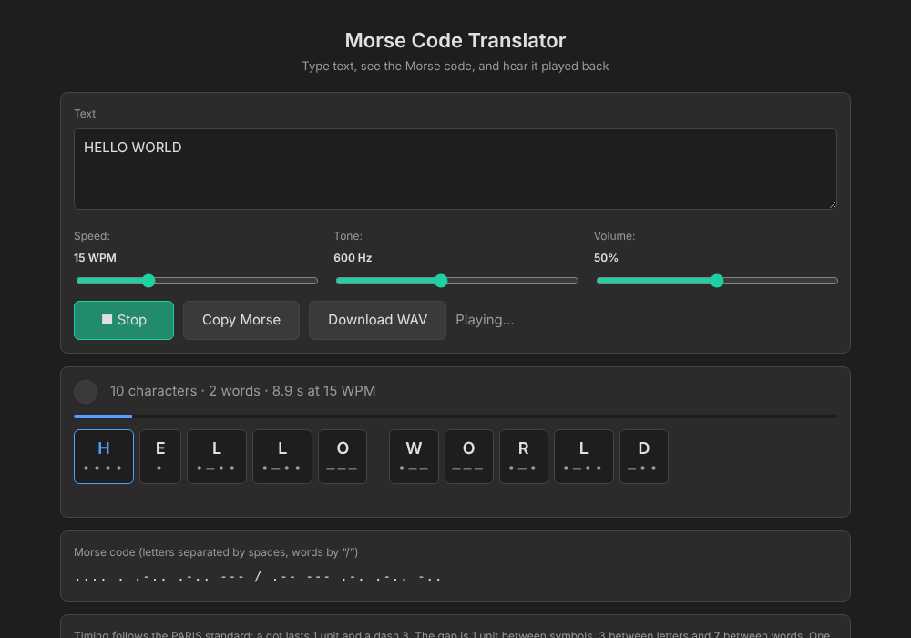

# Morse Code Translator

Type text, see it as Morse code, and hear it played back. A small Python
backend does the encoding and can export the audio as a `.wav` file; the
browser frontend plays it live with the Web Audio API and highlights each
symbol as it sounds.



## Timing

Timing follows the PARIS standard. One unit lasts

$$
T = \frac{1.2}{\mathrm{WPM}} \ \text{seconds}
$$

and everything else is a multiple of it:

| Element | Length |
| --- | --- |
| dot | $1T$ |
| dash | $3T$ |
| gap between symbols | $1T$ |
| gap between letters | $3T$ |
| gap between words | $7T$ |

The word PARIS takes exactly $50$ units, which is how "words per minute" is
defined: $\mathrm{WPM}$ repetitions of it fit in one minute, so
$50\,T \cdot \mathrm{WPM} = 60$ s and $T = 1.2/\mathrm{WPM}$.

Each tone is a sine wave

$$
s(t) = A \, e(t) \sin(2\pi f t)
$$

where $f$ is the pitch and $e(t)$ is a 5 ms linear fade-in and fade-out
envelope. Without the fade, switching a tone on and off abruptly makes an
audible click.

## Project structure

```
.
├── morse.py           # core: table, encoding, timing, WAV synthesis (stdlib only)
├── server.py          # Flask backend: HTTP API
├── cli.py             # command-line interface
├── launch.pyw         # double-click launcher (no console window)
├── requirements.txt
├── static/
│   └── index.html     # frontend: live display and Web Audio playback
├── samples/           # example .wav files
├── tests/
│   └── test_morse.py
└── assets/
    └── screenshot.png
```

## Setup

```bash
pip install -r requirements.txt
```

`morse.py` and `cli.py` need nothing beyond the standard library. Only the web
app needs Flask.

## Usage

### Web app

```bash
python server.py
```

Opens `http://127.0.0.1:8002` in your browser. Closing the tab shuts the server
down on its own. On Windows, `launch.pyw` does the same without a console window.

Controls: speed (5 to 40 WPM), tone (300 to 1000 Hz), volume, **Play / Stop**,
**Copy Morse**, and **Download WAV** (served mode only).
Ctrl+Enter in the text box plays or stops.

`static/index.html` also works on its own: open it directly in a browser and
everything except **Download WAV** is available.

### Command line

```bash
python cli.py "SOS" --wpm 20 --freq 700 --wav sos.wav
```

### API

| Endpoint | Method | Purpose |
| --- | --- | --- |
| `/api/encode` | POST | `{"text": "...", "wpm": 15}` returns Morse string, letters and tone timeline |
| `/api/decode` | POST | `{"morse": "... --- ..."}` returns text |
| `/api/audio.wav` | GET | `?text=&wpm=&freq=&vol=` returns a mono 16-bit WAV |

### Tests

```bash
python -m pytest tests
```

## Supported characters

Letters (accents are stripped), digits, and `. , ? ' ! / ( ) & : ; = + - _ " $ @`.
Anything else is skipped and reported.

## License

MIT, see [LICENSE](LICENSE).
